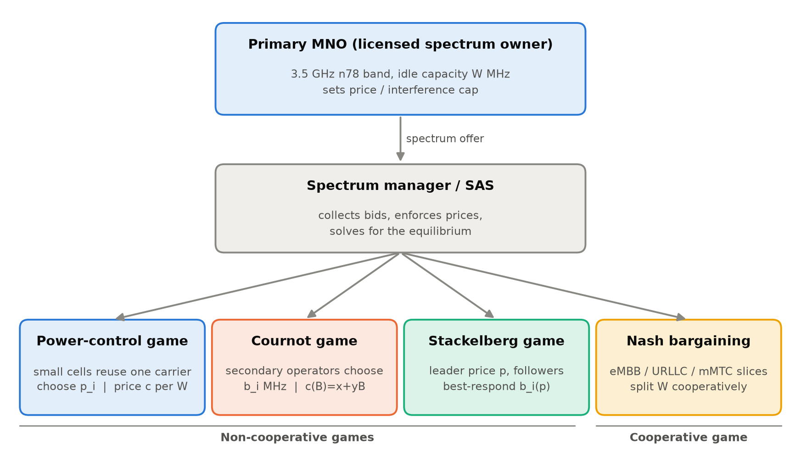
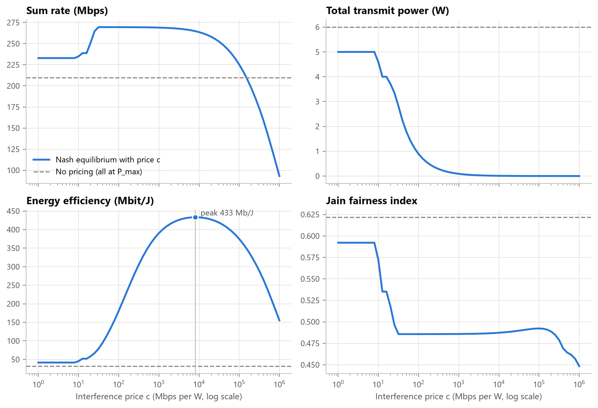
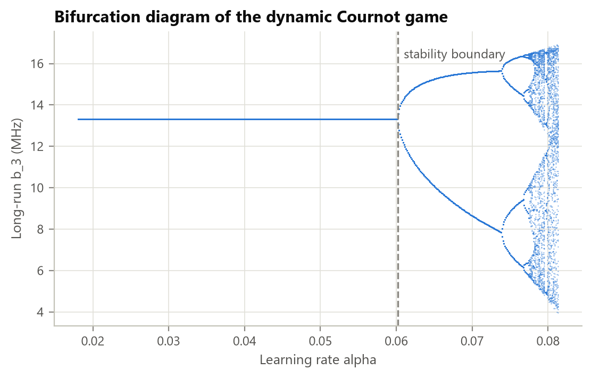
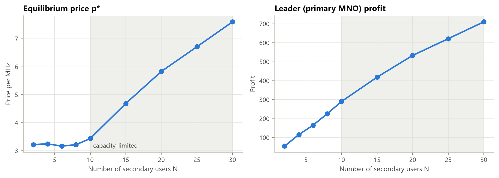
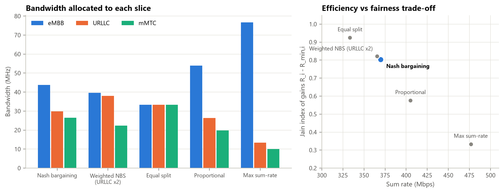

# Game-Theoretic Model for Spectrum Sharing in 5G/6G Networks

A Python framework that models how users and operators share radio spectrum in 5G/6G
networks, using four game-theoretic models. It computes each model's equilibrium on a
realistic 3GPP channel, checks it with automated tests, and compares it against
non-game baselines.

**Team:(Name-Registration number)**
Arnav Anand-2427030154
Aniket Mohanty (2427030143)
Aneesh Srivastava-2427030086
Nihit Karanjawala (2427030145)
Shree Ganesh Manikandan (2427030121)

**Deliverables:** [Project report (PDF)](docs/Project_Report.pdf) ·
[Report (Word)](docs/Project_Report.docx) · [Presentation (PowerPoint)](docs/Project_Presentation.pptx)

---

## Problem

Spectrum is scarce, yet licensed bands are often idle. Dynamic spectrum sharing (CBRS,
LSA, private 5G, network slicing) lets many parties use the same band. Each of those parties
acts in its own interest, so the question is: **how should spectrum and power be shared so
that the outcome is efficient, fair, profitable and stable, without a central controller
that knows everything?**



## The four models

| Model | Players | Strategy | Solution method |
|---|---|---|---|
| **A. Power control with interference pricing** | co-channel small cells | transmit power | best-response dynamics → unique Nash equilibrium |
| **B. Cournot spectrum market** | secondary operators | MHz bought from the primary | Nash equilibrium, collusion benchmark, dynamic-game stability |
| **C. Stackelberg pricing** | primary MNO (leader) vs secondary users | price / bandwidth | backward induction with a capacity constraint |
| **D. Nash bargaining** | eMBB, URLLC, mMTC slices | share of a common band | closed-form weighted Nash bargaining solution |

Channel model: 3GPP TR 38.901 Urban-Micro path loss at 3.5 GHz (band n78), 4 dB log-normal
shadowing, Rayleigh fading, −174 dBm/Hz noise with a 7 dB noise figure.

## Key results

| Experiment | Result |
|---|---|
| Power game (6 cells) | Pricing gives **+28.6% throughput** and **3.0× energy efficiency** vs. full power; converges in 12 rounds |
| Price sweep | Energy efficiency peaks at **13.6×** the unpriced network with almost no throughput loss |
| Network density (40 drops) | Selfish equilibrium reaches **71–80%** of the optimal sum rate; Price of Anarchy ≈ 2 |
| Cournot market | Competition earns 233 total profit vs. 315 under collusion; adaptive bidding is unstable above α = 0.060 |
| Stackelberg | Optimal price 3.24/MHz; owner leases only 55.5 of 100 MHz; price rises sharply once the band fills |
| Nash bargaining | Balances throughput (369.6 Mbps) and fairness between max sum-rate and equal split |

<p align="center">
  
  
</p>
<p align="center">
  
  
</p>

All nine figures are in [`results/`](results/).

## Getting started

Requires Python 3.10 or newer.

```bash
git clone <this-repo-url>
cd <repo-folder>
pip install -r requirements.txt

python main.py                          # run all 6 experiments (~25 s)
python -m unittest tests.test_games -v  # 14 equilibrium checks
```

`main.py` prints every result table. It writes the figures, `console_output.txt` and
`summary.json` to `results/`. Results are reproducible: the same seed always gives
identical figures.

| Option | Default | Effect |
|---|---|---|
| `--seed N` | 7 | different random networks and markets |
| `--quick` | off | 8 Monte Carlo drops instead of 40 |
| `--out DIR` | `results` | output folder |

The model parameters (bandwidth, power limit, prices, slice requirements, etc.) are defined
at the top of each experiment in [`main.py`](main.py) and in
[`spectrum_game/channel.py`](spectrum_game/channel.py).

## Verification

The tests check each equilibrium against its definition, not just that the code runs:

- **Power game:** no link gains by any unilateral change of power; the same equilibrium is reached from any starting point.
- **Cournot:** matches the closed-form solution; the dynamic game converges below the stability limit and diverges above it.
- **Stackelberg:** every follower best-responds; no feasible price gives the leader more profit.
- **Bargaining:** the closed form matches a numerical (SLSQP) solution; all minimum rates are met.

## Project structure

```
spectrum_game/
  channel.py            3GPP path loss, fading, noise, random deployment
  power_game.py         power-control game: best response, Nash solver, social optimum
  cournot_game.py       Cournot market, collusion, dynamic game, stability threshold
  stackelberg_game.py   leader-follower pricing via backward induction
  bargaining.py         weighted Nash bargaining and baseline allocations
  metrics.py            Jain fairness, Price of Anarchy, energy efficiency
  plotting.py           shared figure style
main.py                 experiment driver
tests/test_games.py     equilibrium tests
tools/make_doc_assets.py  diagrams and console screenshots for the docs
results/                generated figures, console log, summary.json
docs/                   report, presentation, assets, build scripts
```

### Rebuilding the report and slides

The report and presentation are generated from `results/summary.json`. After changing an
experiment:

```bash
python main.py
python tools/make_doc_assets.py
cd docs/build
npm install docx pptxgenjs react react-dom react-icons sharp
node build_report.js
node build_deck.js
```

Open the regenerated report in Word and accept the prompt to update fields, which fills
in the table of contents.

## References

1. D. Niyato and E. Hossain, "Competitive pricing for spectrum sharing in cognitive radio networks," *IEEE JSAC*, 2008.
2. R. D. Yates, "A framework for uplink power control in cellular radio systems," *IEEE JSAC*, 1995.
3. C. U. Saraydar, N. B. Mandayam and D. J. Goodman, "Efficient power control via pricing in wireless data networks," *IEEE Trans. Commun.*, 2002.
4. J. F. Nash, "The bargaining problem," *Econometrica*, 1950.
5. Z. Han, D. Niyato, W. Saad, T. Başar and A. Hjørungnes, *Game Theory in Wireless and Communication Networks*, Cambridge University Press, 2012.
6. 3GPP TR 38.901, "Study on channel model for frequencies from 0.5 to 100 GHz."

The full reference list is in the [project report](docs/Project_Report.pdf).
